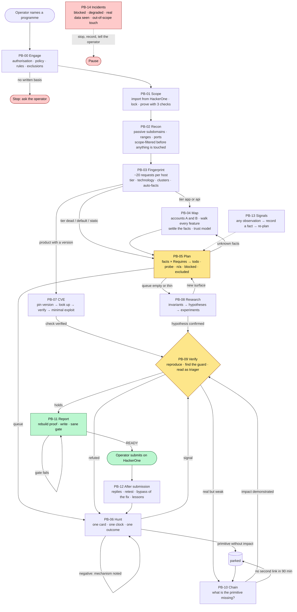
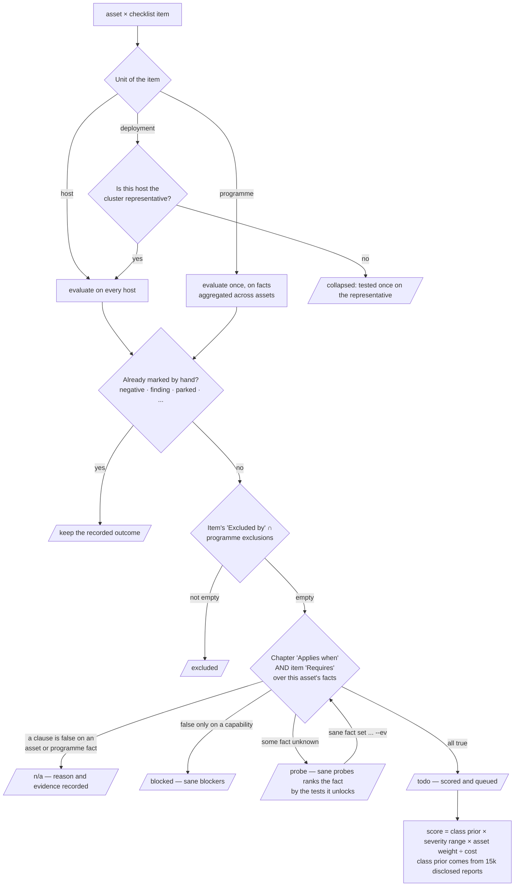
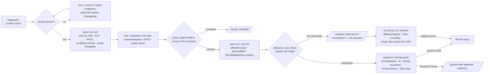
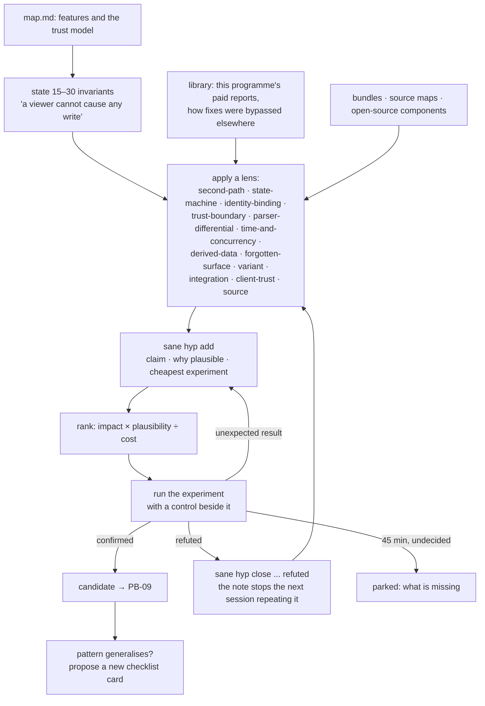

# FLOW — the hunt, drawn

Four diagrams: the whole flow, how one asset × test pair is decided, the CVE path, and the research loop. GitHub
renders them; each node names the playbook or command behind it.

## 1. The whole flow

## 2. How one asset × test pair is decided

This is the part that stops every test being run on every asset.

Facts come from three places: the fingerprinter (`scripts/sane fp`, marked `by: fp`), the mapper's walk of the
application (`scripts/sane fact set`, `by: manual`, always wins), and implication (`needs` in
`checklist/_facts.json`: no HTTP means no login, no login means no password reset).

## 3. The CVE path

A version string is where this starts and never where it ends.

## 4. The research loop

## 5. Clocks

| Unit | Clock | When it runs out |
|---|---|---|
| Card, cost low / medium / high | 20 / 45 / 120 minutes | negative, parked, candidate, or one written extension |
| Hypothesis | 45 minutes to a decisive experiment | parked with what is missing |
| Verification | 45 minutes | park with the conditions observed |
| Chain attempt | 90 minutes | back to parked, missing link named |
| CVE, per product | 60 minutes | negative or parked on the CVE item |
| Research block, per deployment | 3 hours | change deployment or lens |

`scripts/sane start` stamps a card; `scripts/sane status` and the prompt hook show anything overdue; the Stop hook
will not let a turn end on an overdue card or an unverified candidate without a decision.
