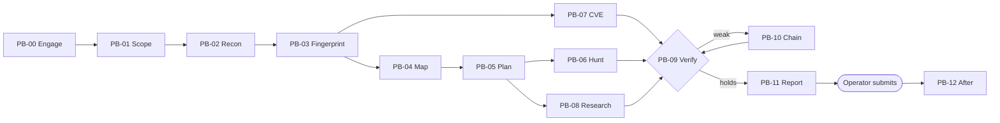

# sane_web

A framework that turns a Claude Code session into a web bug bounty hunter for HackerOne programmes you are
enrolled in. Open this repository in Claude Code, name a programme, and the session works the way an experienced
manual hunter does: it stays inside the scope, learns what each asset is before deciding what to test on it, runs
only the tests that apply, proves what it finds without doing harm, has every candidate checked by reviewers who
did not find it, and writes the report a triager can act on in one read.

It runs on Claude Opus 5.5, Opus 5 or Mythos 5.2. Sibling repositories: `sane_android`, `sane_windows`.

> **Build status:** [`PROGRESS.md`](PROGRESS.md) shows what is written, what is being written right now and what is
> left, refreshed every few minutes during a build. The [build tracker issue](../../issues/53) and the
> [chapter milestone](../../milestone/1) show the same on the Issues tab.

## What is different about it

**It does not run every test on every asset.** Each asset gets a record of *facts* (what it is, what it runs,
which features it has), each of the checklist's test cards declares the facts it `Requires`, and a planner gives
every asset × card pair exactly one status: `todo`, `n/a` with the reason, `blocked` on a missing capability,
`excluded` by the programme, or `probe` when a fact is still unknown. A GraphQL card never reaches a static site.
Hosts that serve the same application are clustered and tested once.

**It is scope-locked.** The scope is imported from HackerOne and enforced by a hook on every shell command: no
scanner, fuzzer or state-changing request reaches a host that is not listed, scanners must carry the programme's
rate limit, and destructive modes, brute forcers and load tools are refused.

**It knows what has paid before.** 15,219 disclosed HackerOne reports are indexed in `kb/`, classified into the
same taxonomy as the checklist and linked to their write-ups. Their statistics set the planner's priorities, every
card cites the reports that show its technique working, and the HexBrain connector serves full write-ups,
bypasses and payloads on demand.

**It is run from playbooks.** Fifteen SOC-style procedures (trigger, steps, decision points, timebox, call-off
rule, exit criteria, next step) cover the hunt from authorisation to triage replies. They are mirrored as GitHub
issues in this repository, and `scripts/sane status` always names the one that applies now.

**It divides the work.** Six hunting lanes per deployment, a planner that says which agents can run side by side
without corrupting each other's sessions or exceeding the rate, complete generated briefs for every delegated
agent, and saved workflows that fan out and verify.

## The flow



The full diagrams, including how one asset × card pair is decided, are in [`FLOW.md`](FLOW.md).

## Quick start

```bash
git clone https://github.com/sanehunters/sane_web && cd sane_web
scripts/install-tools.sh            # optional: free CLI tools; every card also has a curl/Python path
scripts/selftest.sh                 # end-to-end check against a local stand-in target
export H1_USERNAME=<you> H1_TOKEN=<token>        # scope import (hackerone.com/settings/api_token/edit)
export HEXBRAIN_API_KEY=<key>                    # report library connector (hexbrainai.com/account, free)
claude                              # open Claude Code here
```

Then say what you want in plain words:

> Hunt on the `<handle>` programme. My HackerOne user is `<you>`.

The session runs `/engage`, imports the scope and policy, and follows the playbooks. Useful commands along the way:

| You type | It does |
|---|---|
| `/engage <handle>` | records authorisation, reads the policy, sets rate, headers, exclusions |
| `/recon` | passive discovery, fingerprinting, tiers, clusters |
| `/cve-hunt <host>` | product version → CVEs → advisory check → minimal exploit → report |
| `/map <host>` | accounts, authenticated walk, feature map, facts |
| `/plan` | the applicability matrix: what applies where, and why the rest does not |
| `/hunt` | one card at a time, each with a clock |
| `/squad` | divides deployments and lanes across agents and runs them, verifying every candidate |
| `/research <host>` | twelve lenses for bugs no checklist lists |
| `/verify F-001` | three independent attempts to kill a candidate |
| `/report F-001` | the report and proof of concept, gated before you see it |
| `/sane-status` · `/sane-resume` | where things stand · pick up after a break |

You submit. The framework never submits to HackerOne or contacts a programme.

## What is in the repository

| Path | Contents |
|---|---|
| [`CLAUDE.md`](CLAUDE.md) | the standing orders every session and subagent loads |
| [`START.md`](START.md) | the method: facts gate tests, the state machine, how a hunter thinks |
| [`FLOW.md`](FLOW.md) | the hunt, the applicability decision, the CVE path and the research loop, drawn |
| [`playbooks/`](playbooks/README.md) | PB-00 to PB-14, with timeboxes and call-off rules |
| [`checklist/`](checklist/) | 36 chapters of test cards; `_facts.json` is the applicability vocabulary, `_lanes.json` the division into lanes |
| [`kb/`](kb/reports/README.md) | disclosed reports by class and by programme, with links |
| [`docs/`](docs/) | reportability, evidence standard, reporting style, severity, the graveyard, operations, the card schema |
| `scripts/sane` | the console; `scripts/sane help` lists every command |
| `scripts/scope_guard.py` | the hook that enforces scope, rate, required headers and forbidden modes |
| `.claude/` | hooks, 17 skills, 9 subagents, 4 saved workflows |
| `src/` | sources of the skills and agents; `scripts/build_claude.py` embeds the playbooks into them |
| `templates/report.md` | the report skeleton |
| `engagements/` | your programme data and evidence. Git-ignored; never part of this repository |

## The console

```text
scripts/sane new <name> --handle H      scripts/sane plan [--why]         scripts/sane cve <host>
scripts/sane scope import-h1            scripts/sane probes               scripts/sane hyp add|list|close
scripts/sane scope check <host>         scripts/sane next [--lane L]      scripts/sane finding new|list|set
scripts/sane recon                      scripts/sane card <ITEM> <host>   scripts/sane gate F-NNN
scripts/sane fp --all                   scripts/sane start / mark         scripts/sane kb search|program|show
scripts/sane fact set <host> t=1 --ev   scripts/sane lanes | squad        scripts/sane status | coverage
scripts/sane brief <agent> <host>       scripts/sane playbook PB-NN       scripts/sane doctor | lint
```

## Rules it will not break

1. Nothing is sent to a host outside the programme's scope.
2. The programme's rate limit, required headers, account rules and exclusions are followed.
3. Proof is minimal and harmless: your own second account as the victim, a hostname rather than a secret, one
   command's output rather than a shell. No denial of service, no brute force, no real users' data.
4. Nothing is fabricated: no response, screenshot, report id, CVE, score or reproduction.
5. Submission and every message to a programme are yours.

## Maintaining it

| Task | Command |
|---|---|
| Check everything | `scripts/selftest.sh` |
| See which chapters are written and reviewed | `scripts/chapters_todo.py`; [`checklist/README.md`](checklist/README.md); the build tracker issue |
| Write or review what is left (resumable from any machine) | `/build-checklist` in Claude Code: runs the `write-chapters` workflow over `scripts/chapters_todo.py --json` |
| Keep GitHub in step during a build | `GH_TOKEN=... scripts/publish_progress.sh --loop 300` (finished chapters to `main`, everything including drafts to `wip`) |
| Lint the checklist | `scripts/sane lint` (schema: [`docs/11-item-schema.md`](docs/11-item-schema.md)) |
| Rebuild skills and agents after editing a playbook or `src/` | `scripts/build_claude.py` |
| Refresh the report library | `scripts/kb_build.py --refresh`, then `scripts/kb_enrich.py`, then `scripts/kb_build.py` |
| Republish the playbooks as issues | `GH_TOKEN=... scripts/gh_issues.py sync` |

A new test card is a pattern that paid and would apply elsewhere: write it to the schema, give it a precise
`Requires`, cite prior art from `kb/`, and lint.

## Sources and credit

The report index is built from the open [hackerone-reports](https://github.com/reddelexc/hackerone-reports)
dataset; write-ups are served by [HexBrain](https://hexbrainai.com) and belong to their authors and the programmes
that disclosed them. CVE data comes from NVD, CISA KEV and FIRST EPSS at query time. Use this only on systems you
are authorised to test.
